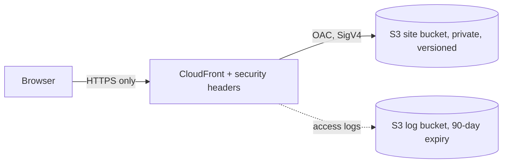

# Architecture: KYC Onboarding Desk POC hosting (dev, us-east-1)

Scope: host the browser-only POC in `apps/html-kyc-onboarding-desk` as a **demo**. It is not the production KYC system in REQ-0044: no real customer data, no real login (users are hard-coded in `js/auth.js`).

## Services
| Service | Role |
|---|---|
| S3 (site) | Static files. Public access blocked, SSE-S3, versioning, TLS-only policy, readable only by this distribution |
| CloudFront | HTTPS redirect, HTTP/2+3, managed CachingOptimized policy, custom response headers policy, PriceClass_100 |
| CloudFront OAC | Signs requests to S3 so the bucket stays private |
| S3 (logs) | CloudFront standard logs, expire after 90 days |

## Decisions
- **OAC, not OAI or S3 website endpoint**: AWS recommends OAC; website endpoints cannot use OAC. Bucket ownership must be *Bucket owner enforced*. ([OAC docs](https://docs.aws.amazon.com/AmazonCloudFront/latest/DeveloperGuide/private-content-restricting-access-to-s3.html))
- **Bucket policy on `AWS:SourceArn`**: lets only this distribution call `s3:GetObject`, so Block Public Access can stay on. ([Secure content delivery](https://docs.aws.amazon.com/whitepapers/latest/secure-content-delivery-amazon-cloudfront/s3-origin-with-cloudfront.html))
- **Response headers policy**: HSTS (1 year), nosniff, frame DENY, referrer policy. CSP is left out because the POC uses inline scripts and a jQuery CDN; the CSP value limit is 1783 characters. ([Headers policies](https://docs.aws.amazon.com/AmazonCloudFront/latest/DeveloperGuide/understanding-response-headers-policies.html))
- **Log bucket uses ACLs**: CloudFront standard logging needs `BucketOwnerPreferred`. A known, accepted exception to the "no ACLs" preference.
- **Default CloudFront certificate**: no custom domain yet. This allows older TLS versions; move to ACM (us-east-1) with `TLSv1.2_2021` before any real use.
- **Not included**: WAF, custom domain, Cognito/SSO, backend, KMS. All are needed before production.
- **old-dashboard.html is not published** (contains a sandbox API key).

## Verified vs unverified
- Verified (AWS Knowledge MCP): OAC behaviour and constraints, response headers policy options, availability of `AWS::CloudFront::Distribution`, `AWS::S3::Bucket`, `AWS::CloudFront::OriginAccessControl` in us-east-1.
- **Unverified** (Terraform MCP failed to connect): AWS provider version (`~> 6.0` kept from the template) and every resource argument name. Run `terraform validate` before trusting them.
- **Unverified**: CloudFront default quotas and pricing.

## Cost drivers (rough, unverified)
CloudFront data transfer and requests (free tier covers a demo), S3 storage (kilobytes), log storage. Expect well under a few dollars a month at demo traffic. No NAT, no load balancer, no database.
